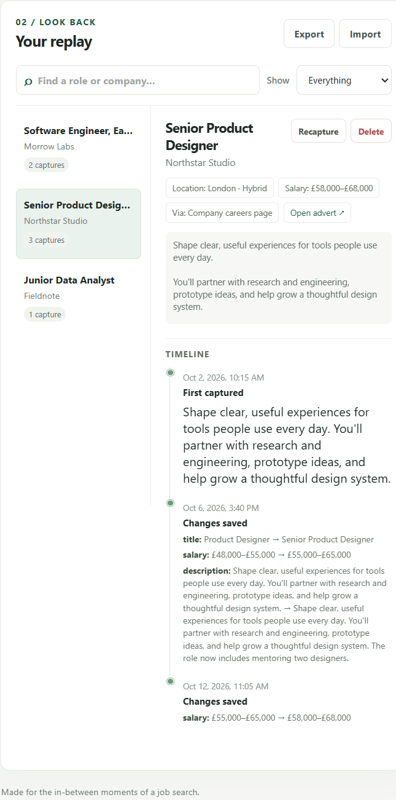

# Replay

**Keep the story behind a job listing.**


Replay is a local-first job-search companion that saves what an advert said
when you found it. Capture it again later and Replay shows what changed—and
what it said before. Your search history stays on your device.



**[Run it locally](#quick-start)** · **[Try the fictional demo](#explore-with-sample-data)** · **[Read the case study](docs/CASE_STUDY.md)**

> **Local-first prototype:** manual capture, no scraping, accounts, analytics,
> or cloud service. You choose what to save.

## What it does

- Save successive versions of an advert and see a readable change timeline.
- Find roles by title, company, location, or source; filter to changed or
  single-capture listings.
- Export a portable JSON backup and restore it later; duplicate snapshots are
  skipped and imports are validated before anything is written.
- Delete a listing and its history when you no longer need it.
- Keep all data in a local SQLite file with no runtime dependencies.

## Why Replay

Job links go stale, descriptions get revised, and salary ranges move. A saved
URL alone cannot tell you what the advert said when you first found it. Replay
keeps dated snapshots so you can return to the history, not just the current
page.

## Quick start

Requires Python 3.11 or newer.

```powershell
python -m venv .venv
.venv\Scripts\Activate.ps1
python -m pip install -e .
job-replay
```

Open <http://127.0.0.1:8000>. Add a role and company, then optionally include
the listing URL, salary, location, source, or description. To capture a later
version, choose the role and press **Recapture** to copy its latest details
into the form, make your edits, and save again.

The database defaults to `~/.job-replay/replay.sqlite3` in your home directory.
Set `JOB_REPLAY_DB` or pass `--database PATH` to use another path. To stop the
app, press Ctrl+C.

### Other shells

```sh
python -m venv .venv
. .venv/bin/activate
python -m pip install -e .
job-replay
```

## Backups

Use **Export** to download a JSON backup containing your listing histories.
Use **Import** to merge a Replay backup into this database. Importing the same
backup more than once is safe: existing snapshots are skipped. Keep backups
private; job-search notes and application plans may contain personal
information.

## Import career-ops postings

Replay can read the discovered-postings table from
[career-ops](https://github.com/MNB4556/career-ops)' SQLite database.
It opens the source database read-only and only imports job adverts; it does
not copy application statuses or private application notes. For example:

```powershell
job-replay --database .\data\replay.sqlite3 --import-career-ops "$env:USERPROFILE\.jobhunt\jobhunt.db"
```

Replace the source path with the database path shown by career-ops on your
machine. Import is repeatable: the same posting and version are not added
twice. Use the Replay web page's **Export** action for a portable backup.

## Explore with sample data

To try the interface without entering a real advert, start Replay and use
**Import** to select [`examples/demo-backup.json`](./examples/demo-backup.json).
It contains three fictional roles and a few deliberately changed versions.
The sample is merged into the current database; use **Delete** on a sample
role to remove it.

## Privacy and security

Replay stores your data in SQLite on your computer. The app binds to
`127.0.0.1` by default, rejects non-local Host headers, and has no login.
**Do not expose it to your network or the public internet.** There are no
external runtime requests; the interface uses system fonts and local assets.
This is a personal-use prototype, not a hardened multi-user service. See the
[case study](docs/CASE_STUDY.md#privacy-boundary) for the current security
boundary and what would need to change before a hosted service.

## Development

```powershell
python -m pip install -e ".[dev]"
pytest
ruff check .
```

The test suite covers snapshot identity and deduplication, export/import and
rollback validation, read-only career-ops import, listing deletion, and the
HTTP API.

## License

This project is licensed under the [MIT License](./LICENSE). See the license
file for the terms and copyright notice.

## Project story

Replay is a local-first prototype, not a production service. The
[case study](docs/CASE_STUDY.md) explains the problem, product choices,
architecture, constraints, validation, and what would be required to take it
further.

## API

- `GET /api/listings` — list current listings
- `GET /api/listings/{id}` — listing details and complete history
- `POST /api/snapshots` — add a listing or save a changed version
- `GET /api/export` — download the versioned backup data
- `POST /api/import` — validate and merge a versioned backup
- `DELETE /api/listings/{id}` — permanently delete a listing and its history

Snapshot fields are `title` and `company` (required), then `url`, `source`,
`location`, `salary`, and `description`. Listings are matched by normalized
URL when provided, otherwise by normalized company and title. Exact repeated
captures are not added to the history.

## Roadmap

- [ ] Import saved application records from career-ops.
- [x] Import discovered postings from career-ops' local SQLite database.
- [ ] Add optional browser-assisted capture with a user-controlled preview.
- [x] Include fictional demo data so the project can be explored quickly.
- [x] Add a maintained product screenshot and project case study.
- [ ] Improve historical comparisons for long descriptions.

No listing data is sent anywhere by this MVP. Browser capture and integrations
will remain opt-in if added.

## Project status

This is an actively developed portfolio project. Local capture, timeline,
search, filtering, deletion, backup/restore, and career-ops discovered-posting
import are implemented and tested. Application-record import and
browser-assisted capture are not implemented yet. The source is MIT-licensed.
