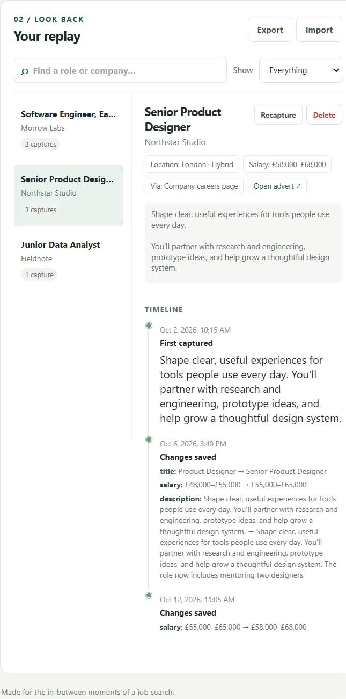

# Replay


A local-first job-search companion that saves what an advert said when you found
it. Capture the same listing again later and Replay shows what changed, and what
it said before. Everything stays on your device.



[Run it locally](#quick-start) · [Try the fictional demo](#explore-with-sample-data) · [Read the case study](docs/CASE_STUDY.md)

This is a personal-use prototype: manual capture, no scraping, no accounts, no
analytics, no cloud service. You choose what to save.

## What it does

- Save successive versions of an advert and see a change timeline.
- Find roles by title, company, location or source; filter to changed or
  single-capture listings.
- Export a JSON backup and restore it later. Duplicate snapshots are skipped and
  imports are validated before anything is written.
- Delete a listing and its history.
- Keep everything in one local SQLite file, with no runtime dependencies.

## Why

Job links go stale, descriptions get revised, and salary ranges move. A saved URL
cannot tell you what the advert said when you first found it. Replay keeps dated
snapshots so you can return to the history rather than only the current page.

## Quick start

Requires Python 3.11 or newer.

```powershell
python -m venv .venv
.venv\Scripts\Activate.ps1
python -m pip install -e .
job-replay
```

Open <http://127.0.0.1:8000>. Add a role and company, then optionally a listing
URL, salary, location, source or description. To capture a later version, choose
the role and press Recapture to copy its latest details into the form, edit them,
and save again.

The database defaults to `~/.job-replay/replay.sqlite3`. Set `JOB_REPLAY_DB` or
pass `--database PATH` to use another path. Ctrl+C stops the app.

### Other shells

```sh
python -m venv .venv
. .venv/bin/activate
python -m pip install -e .
job-replay
```

## Backups

Export downloads a JSON backup of your listing histories. Import merges a backup
into the current database; importing the same backup twice is safe, because
existing snapshots are skipped. Keep backups private, since job-search notes may
contain personal information.

## Importing career-ops postings

Replay can read the discovered-postings table from
[career-ops](https://github.com/MNB4556/career-ops)' SQLite database. It opens the
source database read-only and imports only adverts, not application statuses or
private notes.

```powershell
job-replay --database .\data\replay.sqlite3 --import-career-ops "$env:USERPROFILE\.jobhunt\jobhunt.db"
```

Replace the source path with the one career-ops reports on your machine. The
import is repeatable: the same posting and version are not added twice.

## Explore with sample data

To try the interface without entering a real advert, start Replay and use Import
to select [`examples/demo-backup.json`](./examples/demo-backup.json). It contains
three fictional roles and a few deliberately changed versions. The sample merges
into the current database; use Delete to remove it.

## Privacy and security

Replay stores its data in SQLite on your computer. The app binds to `127.0.0.1`
by default, rejects non-local Host headers, and has no login. Do not expose it to
your network or the internet. There are no external runtime requests; the
interface uses system fonts and local assets. This is a personal-use prototype,
not a hardened multi-user service. The [case study](docs/CASE_STUDY.md) sets out
the current security boundary and what would have to change before hosting it.

## Development

```powershell
python -m pip install -e ".[dev]"
pytest
ruff check .
```

The suite covers snapshot identity and deduplication, export and import with
rollback validation, the read-only career-ops import, listing deletion, and the
HTTP API.

## API

| Method | Path | |
| --- | --- | --- |
| GET | `/api/listings` | list current listings |
| GET | `/api/listings/{id}` | listing details and full history |
| POST | `/api/snapshots` | add a listing or save a changed version |
| GET | `/api/export` | download the versioned backup |
| POST | `/api/import` | validate and merge a versioned backup |
| DELETE | `/api/listings/{id}` | delete a listing and its history |

Snapshot fields are `title` and `company` (required), then `url`, `source`,
`location`, `salary` and `description`. Listings are matched by normalised URL
when one is given, otherwise by normalised company and title. An identical
repeat capture is not added to the history.

## Roadmap

- [ ] Import saved application records from career-ops.
- [x] Import discovered postings from career-ops' local SQLite database.
- [ ] Add optional browser-assisted capture with a user-controlled preview.
- [x] Include fictional demo data so the project can be explored quickly.
- [x] Add a maintained screenshot and case study.
- [ ] Improve historical comparison for long descriptions.

Browser capture and integrations would be opt-in if added. No listing data is
sent anywhere today.

## Status

Local capture, timeline, search, filtering, deletion, backup and restore, and the
career-ops import are implemented and tested. Application-record import and
browser-assisted capture are not. The source is MIT-licensed.
